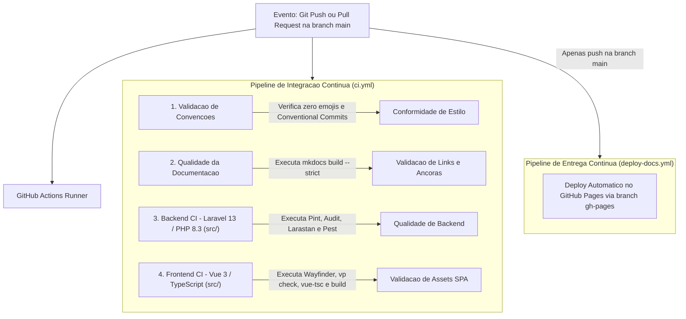

# Pipeline de Integracao e Entrega Continua (CI/CD)

Esta secao documenta a arquitetura de **CI/CD** configurada no repositorio GitHub Actions. A esteira garante a qualidade estrita do codigo em `src/`, conformidade com os padroes operacionais e publicacao automatica da documentacao.

---

## Fluxo da Esteira de CI/CD



---

## 1. Etapas do Pipeline de Integracao Continua (`ci.yml`)

### A. Validacao de Convencoes e Estilo (`conventions-and-style`)
- **Objetivo:** Garantir a observancia estrita das regras documentadas em `.agents/rules/agentrules.md` e na skill `github-flow`.
- **Verificacoes:**
  - Inspecao das mensagens de commit em relacao a branch `main`.
  - Proibicao estrita de emojis no historico Git.
  - Validacao automatica do formato **Conventional Commits** em caixa baixa e sem ponto final.

### B. Qualidade e Integridade da Documentacao (`docs-quality`)
- **Objetivo:** Assegurar que nenhum documento com links quebrados, referencias invalidas ou erros de sintaxe Markdown seja mesclado na branch principal.
- **Comando Executado:**
  ```bash
  mkdocs build --strict
  ```
- **Ambiente:** Python 3.11 com cache de dependencias pip.

### C. Backend CI (`backend-laravel`)
- **Objetivo:** Assegurar a corretude do codigo PHP, tipagem estatica e regras de negocio na aplicacao Laravel 13 localizada no subdiretorio `src/`.
- **Diretorio de Trabalho:** `working-directory: src`
- **Passos Executados:**
  - `composer validate --strict`: Verifica a sintaxe e integridade do manifesto `src/composer.json`.
  - `composer install`: Instalacao de pacotes com cache otimizado para `src/vendor`.
  - `npm ci && npm run build`: Compilacao do manifesto Vite para suporte aos testes de integracao Inertia.js.
  - `composer audit`: Analise de vulnerabilidades de seguranca em pacotes de terceiros.
  - `./vendor/bin/pint --test`: Auditoria de estilo de codigo (padrao Laravel).
  - `./vendor/bin/phpstan analyse --memory-limit=2G`: Analise estatica de nivel 7 via Larastan.
  - `php artisan test`: Execucao da suite de testes automatizados unitarios e de integracao (Pest 5 com SQLite em memoria).

### D. Frontend CI (`frontend-vue`)
- **Objetivo:** Validar a formatacao, tipagem TypeScript e integridade dos componentes Vue 3 e Inertia.js v3 em `src/`.
- **Diretorio de Trabalho:** `working-directory: src`
- **Passos Executados:**
  - `npm ci`: Instalacao reproduzivel de pacotes com cache do Node.js 22 (`src/package-lock.json`).
  - `php artisan wayfinder:generate --with-form`: Geracao de rotas tipadas do Laravel Wayfinder.
  - `npm run check`: Verificacao de linting e formatacao via Vite Plus (`vp check`).
  - `npm run types:check`: Verificacao estrita de tipos TypeScript e templates Vue (`vue-tsc --noEmit`).
  - `npm run build`: Compilacao e empacotamento dos assets do Vite/Tailwind CSS v4 para producao.

---

## 2. Pipeline de Entrega Continua (`deploy-docs.yml`)

- **Gatilho:** Exclusivo para eventos de `push` consolidados na branch `main`.
- **Acao:** Compila a documentacao atualizada e publica diretamente na branch `gh-pages`.
- **Resultado:** Disponibilizacao publica e imediata no endereco:
  `https://lucasssmira.github.io/monitoramento_precos/`

---

## 3. Politica de Concorrencia

Para economia de recursos computacionais e prevencao de condicoes de corrida, ambos os workflows utilizam a diretiva de concorrencia com cancelamento de execucoes obsoletas:

```yaml
concurrency:
  group: ${{ github.workflow }}-${{ github.ref }}
  cancel-in-progress: true
```
Caso novos commits sejam enviados enquanto uma execucao anterior estiver em andamento, o job anterior e cancelado imediatamente em favor do mais recente.
