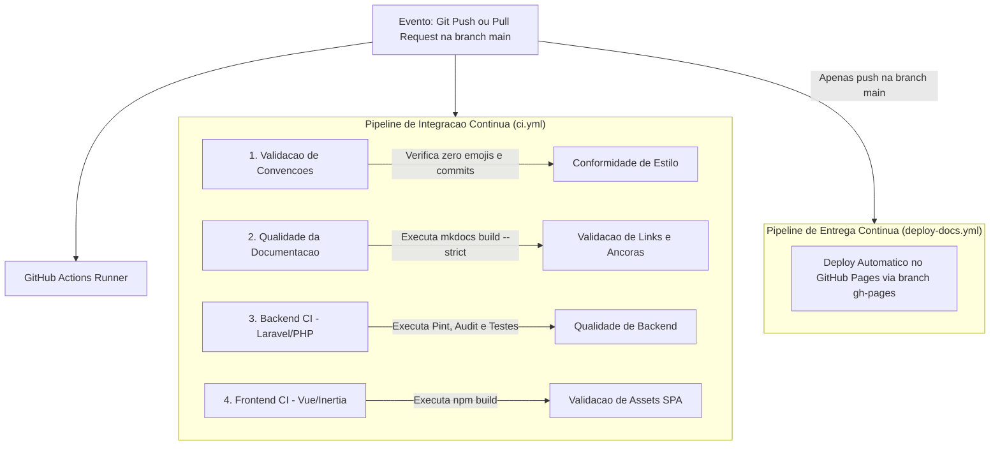

# Pipeline de Integracao e Entrega Continua (CI/CD Day 0)

Esta secao documenta a arquitetura de **CI/CD Day 0** configurada no repositorio GitHub Actions. A esteira garante a qualidade estrita do codigo, conformidade com os padroes operacionais e publicacao automatica desde o momento inicial do projeto.

---

## Fluxo da Esteira de CI/CD



---

## 1. Etapas do Pipeline de Integracao Continua (`ci.yml`)

### A. Validacao de Convencoes e Estilo (`conventions-and-style`)
- **Objetivo:** Garantir a observancia estrita das regras documentadas em `.antigravity/.agentrules`.
- **Verificacoes:**
  - Inspecao das mensagens de commit entre a branch de trabalho e `main`.
  - Proibicao estrita de emojis em mensagens de historico Git.

### B. Qualidade e Integridade da Documentacao (`docs-quality`)
- **Objetivo:** Assegurar que nenhum documento com links quebrados, referencias invalidas ou erros de sintaxe Markdown seja mesclado na branch principal.
- **Comando Executado:**
  ```bash
  mkdocs build --strict
  ```
- **Ambiente:** Python 3.11 com cache de dependencias pip.

### C. Backend CI (`backend-laravel`)
- **Objetivo:** Assegurar a corretude do codigo PHP e regras de negocio na aplicacao Laravel 13.
- **Execucao Condicional:** Ativada automaticamente a partir do momento em que o arquivo `composer.json` esta presente na raiz do projeto.
- **Passos Executados:**
  - `composer validate --strict`: Verifica a sintaxe e integridade do manifesto de dependencias.
  - `composer install`: Instalacao com cache otimizado.
  - `composer audit`: Analise de vulnerabilidades de seguranca em pacotes de terceiros.
  - `vendor/bin/pint --test`: Auditoria de estilo de codigo (padrao Laravel).
  - `php artisan test`: Execucao paralela da suite de testes automatizados unitarios e de integracao.

### D. Frontend CI (`frontend-vue`)
- **Objetivo:** Validar a integridade dos componentes Vue 3 e scripts Inertia.js.
- **Execucao Condicional:** Ativada automaticamente na presenca do arquivo `package.json`.
- **Passos Executados:**
  - `npm ci`: Instalacao reproduzivel de pacotes com cache do Node.js 20.
  - `npm run build`: Compilacao e empacotamento dos assets do Vite/Tailwind, prevenindo erros de tipagem e sintaxe em producao.

---

## 2. Pipeline de Entrega Continua (`deploy-docs.yml`)

- **Gatilho:** Exclusivo para eventos de `push` consolidados na branch `main`.
- **Acao:** Compila a documentacao atualizada e publica diretamente na branch `gh-pages`.
- **Resultado:** Disponibilizacao publica e imediata no endereco:
  `https://lucasssmira.github.io/monitoramento_precos/`

---

## 3. Politica de Concorrencia

Para economia de recursos computacionais e prevencao de condicoes de corrida, ambos os workflows utilizam a diretiva de concorrencia com cancelamento de execucoes obsoletas:

```yaml
concurrency:
  group: ${{ github.workflow }}-${{ github.ref }}
  cancel-in-progress: true
```
Caso novos commits sejam enviados enquanto uma execucao anterior estiver em andamento, o job anterior e cancelado imediatamente em favor do mais recente.
