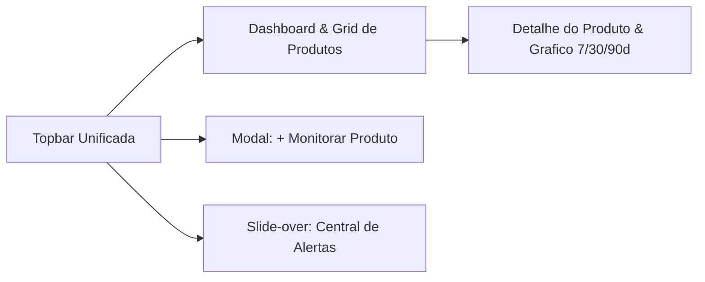

# Identidade Visual e Design System

Esta especificacao documenta a identidade visual, os tokens de design e a arquitetura de componentes adotados na interface web do sistema **Monitoramento de Precos**, implementados com **Vue 3**, **Inertia.js v3** e **Tailwind CSS v4**.

!!! info "Conceito Diretor: Nocturne Emerald & Warm Amber"
    A interface opera **exclusivamente em Modo Escuro (*Dark-First*)**, projetada para reduzir a fadiga visual e eliminar a sobrecarga cognitiva. O sistema visual equilibra a psicologia de **economia inteligente e queda real de precos** (Verde Esmeralda Suave / *Soft Emerald Mint*) com seu **complementar cromatico direto** para **metas, radar ativo e alertas de oportunidade** (Ambar Dourado / *Warm Amber*), sobre uma base profunda de ardosia noturna (*Obsidian Slate*).

---

## 1. Principios de UI e Experiencia do Usuario (UX)

1. **Clareza Financeira Sem Ruido (*Zero Clutter*):** O usuario deve identificar em menos de 2 segundos a resposta para duas perguntas centrais: *"Qual e o preco a vista (PIX) atual?"* e *"Ja atingiu minha meta de compra?"*.
2. **Hierarquia por Contraste de Luminosidade:** Em vez de sombras pesadas ou bordas espessas, a elevacao entre camadas utiliza variacoes sutis de azul-ardosia escuro e bordas finas de `1px`.
3. **Harmonia Complementar Suave:** Substituimos tons saturados agressivos por cores pastel luminosas de alto contraste e legibilidade (conformidade WCAG AA/AAA sobre fundo escuro).
4. **Revelacao Progressiva (*Progressive Disclosure*):** O painel principal prioriza o comparativo entre preco PIX e Preco Alvo; graficos de series temporais (`7`, `30` e `90` dias) e estatisticas detalhadas residem na visao dedicada do produto.

---

## 2. Paleta de Cores (Modo Escuro Exclusivo)

### 2.1 Superficies e Planos de Fundo

| Token CSS | Nome Semantico | Hexadecimal | Aplicacao na Interface |
| :--- | :--- | :---: | :--- |
| `--color-canvas` | **Obsidian Slate** | `#0B0F17` | Plano de fundo global da aplicacao (*Canvas*). |
| `--color-surface` | **Midnight Slate** | `#131B2E` | Superficie de cartoes de produtos, barra superior e containers. |
| `--color-surface-elevated` | **Elevated Slate** | `#1E293B` | Modais, *drawers* deslizantes, menus *dropdown* e estados de *hover*. |
| `--color-surface-border` | **Hairline Mist** | `#26334D` | Bordas estruturais sutis de `1px` para delimitacao de componentes. |

### 2.2 Cores Semanticas e Complementares do Dominio

| Token CSS | Nome Semantico | Hexadecimal | Significado no Escopo de Monitoramento de Precos |
| :--- | :--- | :---: | :--- |
| `--color-primary` | **Soft Emerald Mint** | `#34D399` | **Economia e Preco PIX:** Destaque de preco a vista, queda de preco, meta atingida, menor preco historico e acoes primarias. |
| `--color-on-primary` | **Deep Emerald Ink** | `#064E3B` | Texto de alto contraste sobre botoes e *badges* primarios. |
| `--color-primary-glow` | **Emerald Glow** | `rgba(52, 211, 153, 0.12)` | Preenchimento translúcido de *badges* de desconto e area sob a curva do grafico. |
| `--color-amber` | **Warm Amber Gold** | `#FBBF24` | **Radar e Preco Alvo (Complementar):** Linha de referencia da meta no grafico, *badges* da Central de Alertas, aviso de retorno ao estoque e status de coleta inicial. |
| `--color-amber-glow` | **Amber Glow** | `rgba(251, 191, 36, 0.12)` | Fundo suave para indicadores de gatilho de preco e notificacoes nao lidas. |
| `--color-indigo` | **Soft Indigo** | `#818CF8` | **Analise e Parcelamento:** Serie tracejada de preco a prazo/cartao no grafico e indicadores analiticos secundarios. |
| `--color-coral` | **Soft Coral** | `#F87171` | **Indisponibilidade e Alerta Critico:** Indicador de produto `"Esgotado"`, status `"Instavel"` e confirmacao de exclusao. |

### 2.3 Hierarquia Tipografica de Cores

| Token CSS | Hexadecimal | Aplicacao |
| :--- | :---: | :--- |
| `--color-text-primary` | `#F8FAFC` | Titulos, nomes de produtos e cotações principais (Branco Gelo suave). |
| `--color-text-secondary` | `#94A3B8` | Subtitulos, valores parcelados, categorias e rotulos de formularios. |
| `--color-text-muted` | `#64748B` | Metadados temporais (`"Verificado ha 14 min"`), dominios e itens pausados. |

---

## 3. Tipografia e Fidelidade Numerica

Em uma plataforma de acompanhamento de precos, a leitura instantanea e o alinhamento vertical de cifras monetarias (`R$`) sao requisitos essenciais:

- **Fonte de Interface (Titulos, Rotulos e Navegacao):** `Plus Jakarta Sans` — geometrica, moderna e de alta legibilidade em telas densas.
- **Fonte de Precos e Metricas (`--font-price`):** `JetBrains Mono` com `font-variant-numeric: tabular-nums` obrigatorio em todos os precos (`R$`), percentuais de desconto e carimbos de tempo.

| Escala Tipografica | Fonte | Tamanho / Linha | Peso | Uso Principal |
| :--- | :--- | :---: | :---: | :--- |
| `display-lg` | Plus Jakarta Sans | `36px / 44px` | `700` | Chamada principal na *Landing Page* (`Welcome.vue`). |
| `headline-lg` | Plus Jakarta Sans | `28px / 36px` | `700` | Titulos principais de secoes e cabecalhos de pagina. |
| `headline-md` | Plus Jakarta Sans | `20px / 28px` | `600` | Titulo da barra superior, modais e secoes de graficos. |
| `title-md` | Plus Jakarta Sans | `16px / 24px` | `600` | Titulo do produto nos cards de monitoramento (truncado em 2 linhas). |
| `price-xl` | JetBrains Mono | `26px / 32px` | `700` | Destaque de KPIs e Preco Atual PIX na tela de detalhes. |
| `price-lg` | JetBrains Mono | `20px / 28px` | `700` | Preco a vista (PIX) no bloco comparativo dos cards de produto. |
| `price-md` | JetBrains Mono | `15px / 20px` | `600` | Preco Alvo do usuario e valores em *tooltips* do grafico. |

---

## 4. Arquitetura de Telas e Componentes

### 4.1 Barra Superior Unificada (`AppLayout.vue`)
Substitui menus laterais complexos por uma barra horizontal enxuta com `backdrop-blur`:
- **Identidade:** Icone de radar pulsante em Esmeralda (`#34D399`) + selo `PRO`.
- **Medidor de Capacidade (`RN-010`):** Pilula central exibindo a cota utilizada (`X / 20 monitorados`) com barra de progresso em gradiente Esmeralda para Ambar.
- **Acoes Globais:** Botao da **Central de Alertas** com indicador luminoso Ambar para alertas nao lidos, botao primario **`+ Monitorar Produto`** e menu de conta do usuario.

### 4.2 Dashboard Principal de Produtos (`products/Index.vue`)
1. **Faixa de Resumo (*KPI Strip*):** Tres cartoes sinteticos apresentando *Monitoramentos Ativos*, *Metas Atingidas Agora* (com brilho Esmeralda) e *Maior Economia Real*.
2. **Barra de Busca e Filtros (`RF-006`):** Busca textual instantanea por titulo/apelido combinada com pilulas rapidas de categoria (*Todos, Hardware, Perifericos, Smartphones, Eletro*) e seletor de status (*Todos, Meta Atingida, Ativo, Pausado, Pendente, Instavel*).
3. **Card de Produto (*Grid de 3 Colunas*):**
   - **Cabecalho:** *Badge* cromatico da loja homologada (`Amazon`, `KaBuM!`, `Mercado Livre`, `Magalu`, `Pichau` — `RN-003`), categoria e *badge* semantico de status (`Meta Atingida!`, `Em estoque`, `Coletando dados...`, `Esgotado` ou `Pausado`).
   - **Bloco Comparativo de Precos:** Divide o foco entre **Preco a vista (PIX)** + preco parcelado à esquerda e **Preco Alvo** + diferenca monetaria à direita.
   - **Rodape de Acoes:** Tempo relativo da ultima checagem e acoes diretas para *Verificar agora* (`RF-010`), *Pausar/Retomar* (`RF-008`), *Ver Historico* (`RF-014`) e menu de opcoes (*Editar Meta* `RF-007`, *Ir para a Loja* e *Excluir* `RF-009`).

### 4.3 Detalhe do Produto e Evolucao Grafica (`products/Show.vue` & `PriceHistoryChart.vue`)
- **Cartoes de Inteligencia (`RF-015`):** Destacam lado a lado a *Cotacao Atual PIX vs. Parcelado*, o *Menor Preco Historico* (recorde registrado) e a *Economia Atual* em relacao a media do periodo.
- **Grafico Vetorial de Curvas Suaves (*Spline Area SVG* — `RF-014`):**
  - Seletores segmentados para janelas de **`7 dias`**, **`30 dias`** e **`90 dias`**.
  - **Curva Principal (PIX):** Linha solida Esmeralda (`#34D399`) com preenchimento em gradiente vertical translúcido.
  - **Curva Secundaria (A Prazo):** Linha tracejada em Indigo (`#818CF8`).
  - **Linha de Meta (Preco Alvo):** Linha horizontal pontilhada em Ambar (`#FBBF24`) indicando visualmente o limiar de disparo de alerta.

### 4.4 Modal de Cadastro e Central de Alertas (`MonitorProductDialog.vue` & `AlertsSlideOver.vue`)
- **Modal `+ Monitorar Produto` (`RF-005`):** Formulario enxuto com deteccao automatica das 5 lojas homologadas, campo de Preco Alvo com foco Ambar, seletor de categoria, apelido opcional e *switch* para *"Avisar tambem quando voltar ao estoque"* (`RF-017`).
- **Slide-over e Pagina da Central de Alertas (`RF-016`, `RF-017`):** Lista notificacoes de *Meta de Preco Atingida* (destaque Esmeralda com preco anterior riscado e novo valor PIX) e *Voltou ao Estoque* (destaque Ambar), permitindo marcacao individual ou em lote como lidas e link direto para compra na loja.
