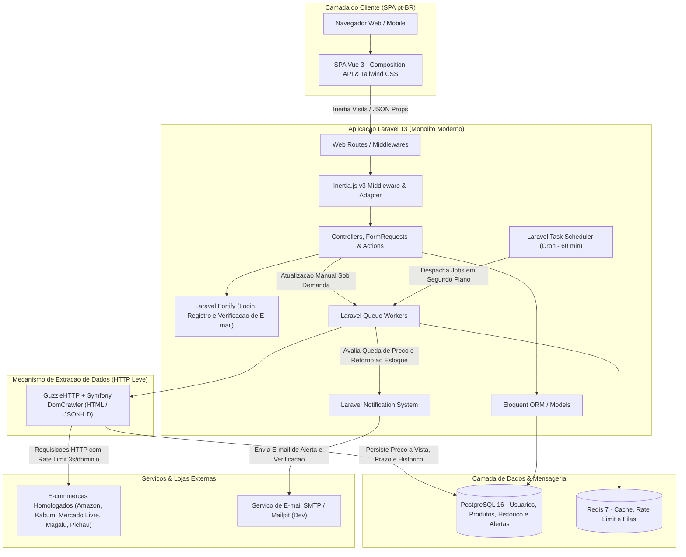

# Visao Arquitetural

Esta pagina apresenta a arquitetura de alto nivel do sistema de **Monitoramento de Precos**, baseada no ecossistema **Laravel 13**, **Inertia.js v3**, **Vue 3** e infraestrutura containerizada via **Docker Compose** (com suporte hibrido ao **Laravel Herd**).

---

## Diagrama Conceitual da Arquitetura

---

## Proposta de Stack Tecnologica

O sistema adota o ecossistema Laravel 13 como nucleo da aplicacao, aproveitando suas convencoes, seguranca integrada e facilidade de manutencao:

| Camada | Tecnologia Definida | Papel na Solucao |
| :--- | :--- | :--- |
| **Infraestrutura & Ambiente Local** | **Docker Compose** *(PHP 8.3, PostgreSQL 16, Redis 7, Mailpit)* / **Laravel Herd** | Ambiente containerizado padronizado e reprodutivel, mantendo compatibilidade total com execucao local via Laravel Herd. |
| **Backend & Framework** | **Laravel 13.x** (PHP 8.3+) | Nucleo da aplicacao: roteamento, controle de acesso, ORM Eloquent, filas assincronas e agendamento de tarefas, configurado integralmente em `pt_BR`. |
| **Camada de Apresentacao (Frontend)** | **Inertia.js v3 + Vue 3** *(Composition API / `<script setup>` / TypeScript)* + **Tailwind CSS v4** | Experiencia fluida de Single Page Application (SPA) sem a complexidade de gerenciar uma API REST separada. Componentes reativos para graficos de historico, formularios e listagens por categoria. |
| **Autenticacao** | **Laravel Fortify** *(Starter Kit Enxuto - Estilo Breeze)* | Autenticacao enxuta e segura com telas em Vue 3 (`pt_BR`) para login, registro, verificacao obrigatoria de e-mail (`MustVerifyEmail`), recuperacao de senha e gerenciamento de perfil, sem complexidade de 2FA ou Passkeys. |
| **Banco de Dados** | **PostgreSQL 16** *(SQLite em memoria para testes)* | Armazenamento relacional dos usuarios, produtos monitorados, serie temporal do historico de precos (a vista e a prazo) e logs de alertas enviados. |
| **Filas, Cache & Rate Limiting** | **Redis 7** | Gerenciamento assincrono das tarefas de coleta de precos, controle de intervalo minimo por dominio (`RN-005`) e disparos de notificacoes em segundo plano. |
| **Extracao de Dados (Scraping)** | **GuzzleHTTP + Symfony DomCrawler** | Requisicoes HTTP leves e parsing de HTML / metadados estruturados (`JSON-LD`) para os 5 e-commerces homologados no sistema. |
| **Sistema de Notificacoes** | **Laravel Notifications (SMTP / Mailpit)** | Envio assincrono de e-mails de verificacao de conta, redefinicao de senha, alertas de queda de preco e alertas de retorno ao estoque, além de registro na Central de Alertas da interface web. |

---

## Principais Modulos do Sistema

1. **Modulo de Autenticacao & Contas:**
   - Gerencia credenciais (e-mail e senha), verificacao obrigatoria de e-mail no cadastro, sessoes seguras, recuperacao de senha e edicao de perfil em `pt_BR`.
2. **Modulo de Produtos (CRUD Completo):**
   - Responsavel pelo cadastro (com higienizacao de URL e validacao de dominio), categorizacao, configuracao de alerta de retorno ao estoque, edicao de parametros, pausa/retomada, atualizacao manual sob demanda e exclusao dos produtos acompanhados.
3. **Modulo de Coleta & Agendamento (*Scraping Engine*):**
   - Executa rotinas em segundo plano a cada 60 minutos atraves do `schedule:run` e filas do Laravel no Redis, extraindo preco a vista/PIX, preco parcelado e disponibilidade em estoque com retentativas exponenciais.
4. **Modulo de Historico, Analise & Alertas:**
   - Registra variacoes reais de preco na serie temporal, apresenta graficos evolutivos de 7, 30 e 90 dias com destaque de menor preco historico e aciona notificacoes por e-mail respeitando a politica de *cooldown* de 6 horas.
