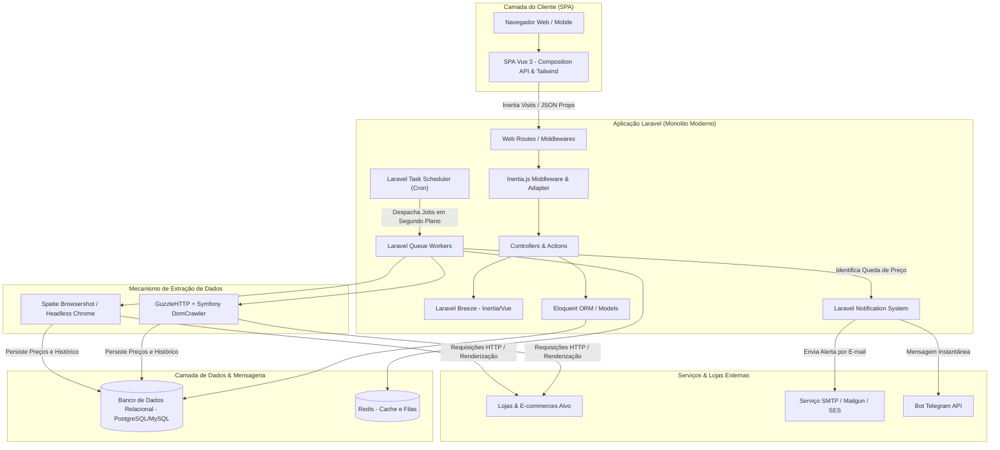

# Visão Arquitetural

Esta página apresenta a arquitetura de alto nível do sistema de **Monitoramento de Preços**, baseada no ecossistema **Laravel**.

---

## 🏛️ Diagrama Conceitual da Arquitetura

---

## 🛠️ Proposta de Stack Tecnológica

O sistema adota o ecossistema Laravel como núcleo da aplicação, aproveitando suas convenções, segurança integrada e facilidade de manutenção:

| Camada | Tecnologia Definida | Papel na Solução |
| :--- | :--- | :--- |
| **Ambiente de Desenvolvimento** | **Laravel Herd** | Ambiente local de alta performance com gerenciamento integrado de PHP, Nginx, Node.js e DNS local sem dependência de Docker pesado. |
| **Backend & Framework** | **Laravel 13.x** (PHP 8.3+) | Núcleo da aplicação: roteamento, controle de acesso, ORM Eloquent, filas assíncronas e agendamento de tarefas. |
| **Camada de Apresentação (Frontend)** | **Inertia.js + Vue 3** *(Composition API / `<script setup>`)* + **Tailwind CSS** | Experiência fluida de Single Page Application (SPA) sem a complexidade de gerenciar uma API REST/GraphQL separada. Componentes reativos para gráficos, formulários e listagens dinâmicas. |
| **Autenticação** | **Laravel Breeze** *(Stack Inertia/Vue)* | Scaffold oficial e seguro com telas em Vue 3 para login, registro, recuperação de senha e proteção CSRF integrada. |
| **Banco de Dados** | **PostgreSQL** *(ou MySQL / SQLite via Herd)* | Armazenamento relacional dos usuários, produtos monitorados e série temporal do histórico de preços. |
| **Filas & Cache** | **Redis** *(ou driver Database)* | Gerenciamento assíncrono das tarefas de monitoramento e disparos de notificações em segundo plano sem travar a interface. |
| **Extração de Dados (Scraping)** | **GuzzleHTTP + Symfony DomCrawler** | Requisições HTTP ultrarrápidas e parsing de HTML para e-commerces com renderização tradicional. |
| **Renderização Avançada (Opcional)** | **Spatie Browsershot** | Coleta headless baseada em Chromium para lojas que exigem renderização via JavaScript. |
| **Sistema de Notificações** | **Laravel Notifications** | Canal unificado para envio de e-mails (SMTP) e mensagens via Telegram (`laravel-notification-channels/telegram`). |

---

## ⚙️ Principais Módulos do Sistema

1. **Módulo de Autenticação & Contas:**
   - Gerencia credenciais, sessões seguras e perfis de usuários com suas respectivas configurações de contato.
2. **Módulo de Produtos (CRUD):**
   - Responsável pelo cadastro, edição, desativação temporária e exclusão dos produtos acompanhados.
3. **Módulo de Coleta & Agendamento (*Scraping Engine*):**
   - Executa rotinas em segundo plano através do `schedule:run` e filas do Laravel, distribuindo as checagens de preços em lotes.
4. **Módulo de Análise & Alertas:**
   - Compara o valor obtido na coleta contra o preço-alvo estipulado pelo usuário e aciona a camada de notificações quando uma oportunidade é detectada.
