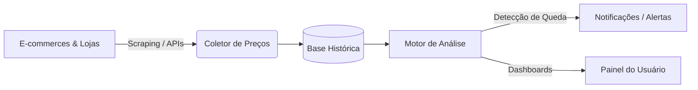

# Sistema de Monitoramento de Preços

Bem-vindo à documentação oficial do projeto **Monitoramento de Preços**. Este espaço centraliza os artefatos de engenharia de software, especificações de requisitos, arquitetura e decisões técnicas da solução.

---

## 🎯 Objetivo do Projeto

O sistema tem como finalidade rastrear, comparar e analisar variações históricas de preços de produtos em diferentes plataformas de e-commerce, alertando usuários sobre quedas de preço e identificando promoções reais.



---

## 📚 Estrutura da Documentação

A documentação está organizada nas seguintes seções principais:

=== "📋 Requisitos do Sistema"
    - [**Visão Geral de Requisitos**](requisitos/index.md): Metodologia, priorização MoSCoW e convenções de nomenclatura.
    - [**Story Map**](requisitos/story-map.md): Mapa de histórias e planejamento incremental (MVP e releases futuras).
    - [**Requisitos Funcionais (RF)**](requisitos/funcionais.md): Funcionalidades e comportamentos esperados pelo sistema.
    - [**Requisitos Não-Funcionais (RNF)**](requisitos/nao-funcionais.md): Critérios de desempenho, segurança, disponibilidade e usabilidade.
    - [**Regras de Negócio (RN)**](requisitos/regras-de-negocio.md): Políticas e regras de cálculo e validação do domínio.
    - [**Histórias de Usuário (US)**](requisitos/historias-de-usuario.md): Visão ágil com critérios de aceitação (Given-When-Then).
    - [**Matriz de Rastreabilidade**](requisitos/rastreabilidade.md): Cruzamento de requisitos para garantia de cobertura.

=== "🏛️ Arquitetura"
    - [**Visão Arquitetural**](arquitetura/visao-geral.md): Componentes, diagramas conceituais e visão macro da infraestrutura.

---

## 🚀 Como Executar esta Documentação Localmente

Para iniciar o servidor local de documentação com recarga em tempo real (*live reload*):

```bash
# 1. Criar e ativar o ambiente virtual (recomendado)
python -m venv .venv
.\.venv\Scripts\Activate.ps1   # PowerShell no Windows

# 2. Instalar dependências
pip install -r requirements.txt

# 3. Executar o servidor local
mkdocs serve
```

Acesse em seu navegador: [http://127.0.0.1:8000](http://127.0.0.1:8000)
