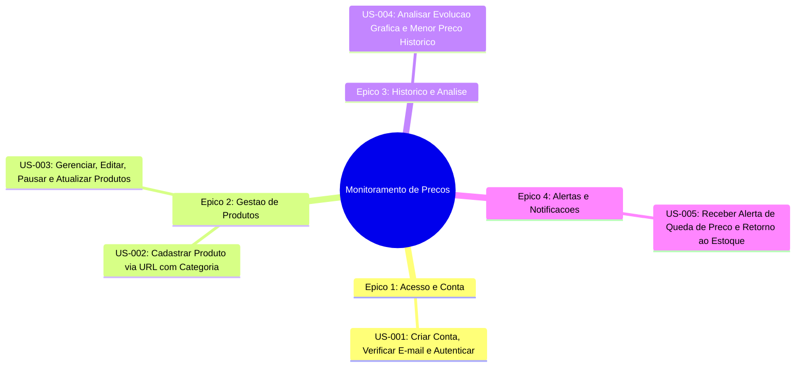

# Historias de Usuario (US)

As Historias de Usuario capturam as necessidades dos usuarios finais no formato agil, associadas aos seus respectivos **Criterios de Aceitacao** no padrao BDD (*Given-When-Then*), todas consolidadas para a **Release 1 (MVP Completo)**.

---

## Epicos e Historias



---

## Especificacao das Historias

### US-001: Criar Conta, Verificar E-mail e Autenticar
- **Epico:** Acesso & Conta
- **Requisitos Associados:** [RF-001](funcionais.md#rf-001-cadastro-de-usuario-e-verificacao-de-e-mail), [RF-002](funcionais.md#rf-002-autenticacao-e-gestao-de-sessao), [RF-003](funcionais.md#rf-003-recuperacao-de-senha), [RF-004](funcionais.md#rf-004-gerenciamento-de-perfil-e-conta), [RN-001](regras-de-negocio.md#rn-001-unicidade-de-credenciais-de-usuario), [RN-002](regras-de-negocio.md#rn-002-bloqueio-por-tentativas-invalidas-de-login)
- **Historia:**
  > **Como** comprador online,  
  > **Quero** criar uma conta em Portugues com meu e-mail e senha, confirmar meu endereco de e-mail e realizar login de forma simples,  
  > **Para que** eu possa acessar com seguranca meu painel exclusivo de monitoramento de precos.

#### Criterios de Aceitacao (BDD):

```gherkin
Cenario: Cadastro bem-sucedido com envio de verificacao de e-mail
  Dado que estou na pagina de cadastro em Portugues (pt_BR)
  Quando preencho meu nome, um e-mail valido nao cadastrado e senha com 8 ou mais caracteres
  E clico no botao "Criar conta"
  Entao minha conta deve ser criada com sucesso
  E um e-mail de verificacao deve ser enviado para o meu endereco
  E devo ser direcionado para a tela de confirmacao de e-mail antes de acessar o painel principal.

Cenario: Cadastro com e-mail ja utilizado
  Dado que estou na pagina de cadastro
  Quando informo um endereco de e-mail que ja existe no sistema
  E tento submeter o formulario
  Entao o sistema deve exibir a mensagem de validacao "Este e-mail já está em uso."
  E nao deve criar uma nova conta.
```

---

### US-002: Cadastrar Produto via URL com Categoria
- **Epico:** Gestao de Produtos
- **Requisitos Associados:** [RF-005](funcionais.md#rf-005-cadastro-de-produto-para-monitoramento), [RF-010](funcionais.md#rf-010-coleta-automatica-periodica-e-sob-demanda), [RF-011](funcionais.md#rf-011-extracao-de-preco-a-vista-a-prazo-e-disponibilidade), [RN-003](regras-de-negocio.md#rn-003-validacao-de-dominios-suportados), [RN-004](regras-de-negocio.md#rn-004-unicidade-de-url-por-usuario), [RN-010](regras-de-negocio.md#rn-010-limite-de-produtos-por-usuario)
- **Historia:**
  > **Como** usuario autenticado e verificado,  
  > **Quero** informar a URL de um produto, definir meu preco alvo, escolher uma categoria e indicar se desejo aviso de retorno ao estoque,  
  > **Para que** o sistema colete os precos a vista (PIX) e a prazo automaticamente em segundo plano.

#### Criterios de Aceitacao (BDD):

```gherkin
Cenario: Cadastro assincrono com URL de e-commerce suportado
  Dado que estou autenticado na pagina de produtos e possuo menos de 20 produtos cadastrados
  Quando informo a URL valida de uma loja suportada (Amazon, Kabum, Mercado Livre, Magalu ou Pichau), um preco alvo de R$ 1.500,00 e a categoria "Hardware"
  E clico em "Iniciar Monitoramento"
  Entao o produto deve ser registrado imediatamente com status "Pendente / Coletando dados..."
  E um Job assincrono deve ser enfileirado para extrair o titulo, imagem, preco a vista (PIX), preco a prazo e disponibilidade.

Cenario: Cadastro com dominio ainda nao suportado
  Dado que estou na tela de cadastro de produto
  Quando informo uma URL de um dominio desconhecido
  Entao o sistema deve exibir o aviso "O domínio informado ainda não é suportado pelo sistema."
  E nao deve persistir o produto.
```

---

### US-003: Gerenciar, Editar, Pausar e Atualizar Produtos
- **Epico:** Gestao de Produtos
- **Requisitos Associados:** [RF-006](funcionais.md#rf-006-listagem-e-consulta-de-produtos), [RF-007](funcionais.md#rf-007-edicao-de-parametros-do-produto), [RF-008](funcionais.md#rf-008-pausar-e-retomar-monitoramento), [RF-009](funcionais.md#rf-009-exclusao-de-produto-monitorado), [RF-010](funcionais.md#rf-010-coleta-automatica-periodica-e-sob-demanda), [RN-005](regras-de-negocio.md#rn-005-intervalo-minimo-de-coleta-por-dominio)
- **Historia:**
  > **Como** usuario autenticado,  
  > **Quero** filtrar meus produtos por categoria, editar o preco alvo, pausar/retomar o monitoramento, solicitar uma checagem manual ("Verificar agora") ou excluir itens,  
  > **Para que** eu tenha controle completo sobre minha lista de acompanhamento.

#### Criterios de Aceitacao (BDD):

```gherkin
Cenario: Editar parametros do produto sem perder historico
  Dado que possuo o produto "Placa de Video" monitorado na minha lista
  Quando edito o preco alvo para R$ 2.100,00, altero a categoria para "Hardware" e ativo a opcao de alerta de retorno ao estoque
  Entao os novos parametros devem ser salvos com sucesso
  E todo o historico de precos ja coletado para o item deve permanecer intacto.

Cenario: Solicitar atualizacao manual sob demanda ("Verificar agora")
  Dado que possuo um produto ativo cuja ultima atualizacao manual ocorreu ha mais de 10 minutos
  Quando clico no botao "Verificar agora"
  Entao o sistema deve enfileirar imediatamente uma nova coleta em segundo plano para atualizar os precos a vista e a prazo.

Cenario: Excluir produto monitorado
  Dado que possuo o produto "Headphone Bluetooth" na minha lista
  Quando clico no botao "Excluir" e confirmo o modal de alerta
  Entao o produto e seu historico devem ser removidos definitivamente da minha lista.
```

---

### US-004: Analisar Evolucao Grafica e Menor Preco Historico
- **Epico:** Historico & Analise
- **Requisitos Associados:** [RF-013](funcionais.md#rf-013-armazenamento-do-historico-de-precos), [RF-014](funcionais.md#rf-014-visualizacao-grafica-da-evolucao-de-precos), [RF-015](funcionais.md#rf-015-destaque-de-menor-preco-historico), [RN-007](regras-de-negocio.md#rn-007-descarte-de-leituras-duplicadas-sem-variacao)
- **Historia:**
  > **Como** usuario autenticado,  
  > **Quero** visualizar um grafico com a evolucao dos precos nos ultimos 7, 30 ou 90 dias e consultar o menor preco historico ja registrado,  
  > **Para que** eu saiba se o desconto atual e uma promocao real antes de comprar.

#### Criterios de Aceitacao (BDD):

```gherkin
Cenario: Visualizacao do grafico e menor preco historico
  Dado que acesso a pagina de detalhes de um produto monitorado com historico registrado
  Quando seleciono o filtro de periodo de "30 dias"
  Entao o sistema deve renderizar o grafico de oscilacao de precos do periodo
  E exibir em destaque o Menor Preco Historico detectado e o percentual de economia em relacao ao preco medio.
```

---

### US-005: Receber Alerta de Queda de Preco e Retorno ao Estoque
- **Epico:** Alertas e Notificacoes
- **Requisitos Associados:** [RF-016](funcionais.md#rf-016-disparo-de-notificacao-por-e-mail-e-central-de-alertas), [RF-017](funcionais.md#rf-017-alerta-de-retorno-ao-estoque), [RN-008](regras-de-negocio.md#rn-008-condicao-de-disparo-de-alerta), [RN-009](regras-de-negocio.md#rn-009-evitar-notificacoes-repetitivas-cooldown)
- **Historia:**
  > **Como** usuario autenticado com produto cadastrado,  
  > **Quero** ser notificado por e-mail e visualizar na Central de Alertas quando o preco a vista cair para um valor igual ou inferior ao meu preco alvo ou quando um item esgotado voltar ao estoque,  
  > **Para que** eu possa efetuar a compra com economia antes do termino da promocao.

#### Criterios de Aceitacao (BDD):

```gherkin
Cenario: Disparo de notificacao por e-mail e registro na Central de Alertas
  Dado que tenho um monitoramento ativo com preco alvo de R$ 300,00
  Quando a rotina de coleta identificar que o preco atual a vista (PIX) caiu para R$ 280,00
  E o item estiver disponivel em estoque
  Entao um e-mail deve ser despachado contendo o titulo do produto, preco anterior, preco promocional a vista, preco a prazo e link de compra
  E o alerta deve ficar visivel no historico da Central de Alertas na interface web.

Cenario: Disparo de alerta de retorno ao estoque
  Dado que tenho um produto que estava "Esgotado" e com a opcao "Avisar tambem quando voltar ao estoque" marcada
  Quando uma nova coleta identificar que o produto voltou a ficar "Disponivel"
  Entao o sistema deve enviar um e-mail informando o retorno ao estoque e registra-lo na Central de Alertas.
```
