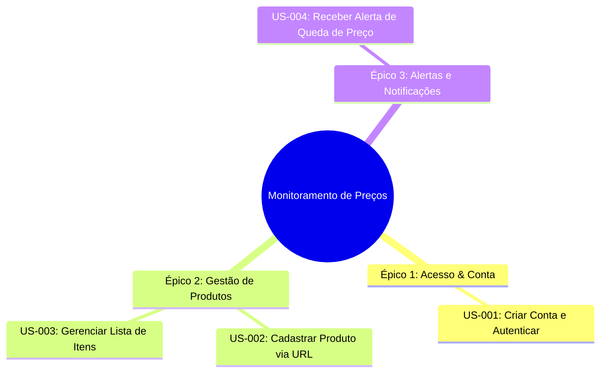

# Histórias de Usuário (US)

As Histórias de Usuário capturam as necessidades dos usuários finais no formato ágil, associadas aos seus respectivos **Critérios de Aceitação** no padrão BDD (*Given-When-Then*).

---

## 🗂️ Épicos e Histórias



---

## 👤 Especificação das Histórias

### US-001: Criar Conta e Autenticar
- **Épico:** Acesso & Conta
- **Requisitos Associados:** [RF-001](funcionais.md#rf-001-cadastro-de-usuario), [RF-002](funcionais.md#rf-002-autenticacao-e-gestao-de-sessao), [RN-001](regras-de-negocio.md#rn-001-unicidade-de-credenciais-de-usuario), [RN-002](regras-de-negocio.md#rn-002-bloqueio-por-tentativas-invalidas-de-login)
- **História:**
  > **Como** comprador online,  
  > **Quero** criar uma conta com meu e-mail e senha e realizar login de forma rápida,  
  > **Para que** eu possa acessar meu painel exclusivo de monitoramento de preços.

#### Critérios de Aceitação (BDD):

```gherkin
Cenário: Cadastro bem-sucedido
  Dado que estou na página de cadastro
  Quando preencho meu nome, um e-mail válido não cadastrado e senha com 8 ou mais caracteres
  E clico no botão "Cadastrar"
  Então minha conta deve ser criada com sucesso
  E devo ser redirecionado autenticado para o dashboard.

Cenário: Cadastro com e-mail já utilizado
  Dado que estou na página de cadastro
  Quando informo um endereço de e-mail que já existe no sistema
  E tento submeter o formulário
  Então o sistema deve exibir a mensagem de validação "Este e-mail já está em uso."
  E não deve criar uma nova conta.
```

---

### US-002: Cadastrar Produto via URL
- **Épico:** Gestão de Produtos
- **Requisitos Associados:** [RF-005](funcionais.md#rf-005-cadastro-de-produto-para-monitoramento), [RN-003](regras-de-negocio.md#rn-003-validacao-de-dominios-suportados), [RN-004](regras-de-negocio.md#rn-004-unicidade-de-url-por-usuario)
- **História:**
  > **Como** usuário autenticado,  
  > **Quero** informar a URL de um produto e definir meu preço alvo desejado,  
  > **Para que** o sistema passe a monitorar o valor automaticamente em segundo plano.

#### Critérios de Aceitação (BDD):

```gherkin
Cenário: Cadastro com URL de e-commerce suportado
  Dado que estou autenticado na página de produtos
  Quando informo a URL válida de uma loja suportada e um preço alvo de R$ 1.500,00
  E clico em "Iniciar Monitoramento"
  Então o produto deve ser enfileirado para coleta
  E passar a constar na minha listagem de produtos ativos.

Cenário: Cadastro com domínio ainda não suportado
  Dado que estou na tela de cadastro de produto
  Quando informo uma URL de um domínio desconhecido
  Então o sistema deve exibir o aviso "O domínio informado ainda não é suportado pelo sistema."
  E não deve persistir o produto.
```

---

### US-003: Gerenciar Lista de Itens
- **Épico:** Gestão de Produtos
- **Requisitos Associados:** [RF-006](funcionais.md#rf-006-listagem-e-consulta-de-produtos), [RF-009](funcionais.md#rf-009-exclusao-de-produto-monitorado)
- **História:**
  > **Como** usuário autenticado,  
  > **Quero** visualizar todos os meus produtos monitorados e poder excluir itens que não me interessam mais,  
  > **Para que** meu painel contenha apenas os itens relevantes para compra.

#### Critérios de Aceitação (BDD):

```gherkin
Cenário: Excluir produto monitorado
  Dado que possuo o produto "Headphone Bluetooth" na minha lista
  Quando clico no botão "Excluir" e confirmo o modal de alerta
  Então o produto deve ser removido da minha lista
  E as rotinas de coleta periódica para esse item devem ser canceladas.
```

---

### US-004: Receber Alerta de Queda de Preço
- **Épico:** Alertas e Notificações
- **Requisitos Associados:** [RF-016](funcionais.md#rf-016-disparo-de-notificacao-por-e-mail), [RN-008](regras-de-negocio.md#rn-008-condicao-de-disparo-de-alerta), [RN-009](regras-de-negocio.md#rn-009-evitar-notificacoes-repetitivas-cooldown)
- **História:**
  > **Como** usuário autenticado com produto cadastrado,  
  > **Quero** ser notificado assim que o preço de um item cair para um valor igual ou inferior ao meu preço alvo,  
  > **Para que** eu possa efetuar a compra com economia antes do término da promoção.

#### Critérios de Aceitação (BDD):

```gherkin
Cenário: Disparo de notificação por e-mail com sucesso
  Dado que tenho um monitoramento ativo com preço alvo de R$ 300,00
  Quando a rotina de coleta identificar que o preço atual caiu para R$ 280,00
  E o item estiver em estoque
  Então um e-mail deve ser despachado contendo o título do produto, preço anterior, preço promocional e link de compra.
```
