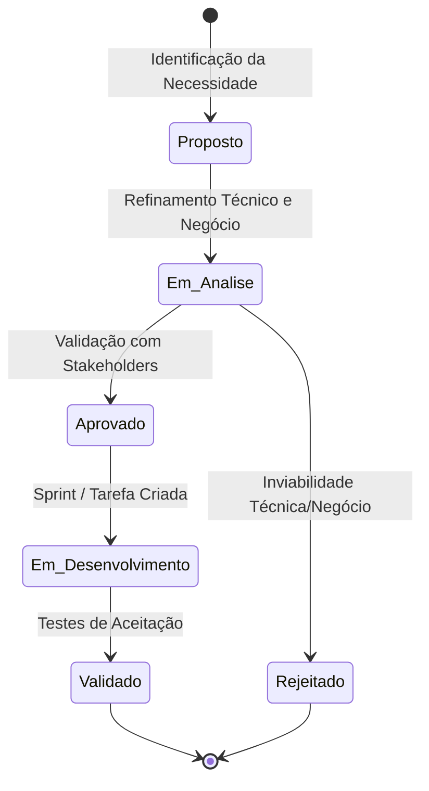

# Engenharia de Requisitos - Visão Geral

Esta seção consolida a especificação dos requisitos do projeto **Monitoramento de Preços**. A metodologia adotada combina rigor de rastreabilidade com agilidade na evolução dos artefatos.

---

## 🏷️ Convenções de Nomenclatura

Para garantir consistência e fácil rastreabilidade entre código, testes e documentação, utilizamos os seguintes prefixos padronizados:

| Prefixo | Tipo de Artefato | Descrição | Exemplo |
| :--- | :--- | :--- | :--- |
| **`RF-xxx`** | Requisito Funcional | Ações, comportamentos e funções executadas pelo sistema | `RF-001` |
| **`RNF-xxx`** | Requisito Não-Funcional | Restrições técnicas, qualidade e atributos de desempenho | `RNF-001` |
| **`RN-xxx`** | Regra de Negócio | Políticas e restrições de domínio aplicadas aos processos | `RN-001` |
| **`US-xxx`** | História de Usuário | Necessidades do usuário final sob perspectiva ágil | `US-001` |

---

## ⚖️ Classificação de Prioridade (Método MoSCoW)

Todos os requisitos funcionais e não-funcionais são categorizados utilizando o método **MoSCoW**:

- :red_circle: **Must have (Obrigatório):** Crítico para a viabilidade do MVP (Produto Mínimo Viável). O sistema não pode ser lançado sem este item.
- :orange_circle: **Should have (Importante):** Alta relevância e valor agregado, mas não impede a operação inicial caso postergado para a próxima iteração.
- :yellow_circle: **Could have (Desejável):** Melhoria conveniente ou diferencial competitivo que será implementado se houver tempo e recursos.
- :white_circle: **Won't have (Não prioritário no momento):** Identificado e acordado como fora do escopo da versão atual, mas registrado para versões futuras.

---

## 🔄 Ciclo de Vida dos Requisitos

---

## 📑 Navegação Rápida

- 👉 [Consultar Story Map (Mapeamento de Histórias)](story-map.md)
- 👉 [Consultar Requisitos Funcionais (RF)](funcionais.md)
- 👉 [Consultar Requisitos Não-Funcionais (RNF)](nao-funcionais.md)
- 👉 [Consultar Regras de Negócio (RN)](regras-de-negocio.md)
- 👉 [Consultar Histórias de Usuário (US)](historias-de-usuario.md)
- 👉 [Consultar Matriz de Rastreabilidade](rastreabilidade.md)
