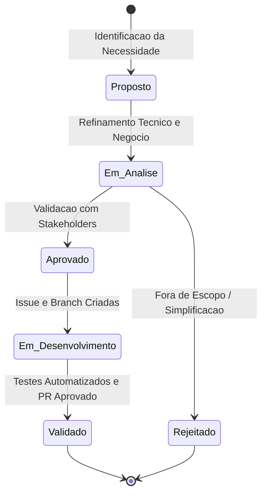

# Engenharia de Requisitos - Visao Geral

Esta secao consolida a especificacao dos requisitos do projeto **Monitoramento de Precos**. A metodologia adotada combina rigor de rastreabilidade com agilidade na evolucao dos artefatos.

---

## Convencoes de Nomenclatura

Para garantir consistencia e facil rastreabilidade entre codigo, testes e documentacao, utilizamos os seguintes prefixos padronizados:

| Prefixo | Tipo de Artefato | Descricao | Exemplo |
| :--- | :--- | :--- | :--- |
| **`RF-xxx`** | Requisito Funcional | Acoes, comportamentos e funcoes executadas pelo sistema | `RF-001` |
| **`RNF-xxx`** | Requisito Nao-Funcional | Restricoes tecnicas, qualidade e atributos de desempenho | `RNF-001` |
| **`RN-xxx`** | Regra de Negocio | Politicas e restricoes de dominio aplicadas aos processos | `RN-001` |
| **`US-xxx`** | Historia de Usuario | Necessidades do usuario final sob perspectiva agil | `US-001` |

---

## Classificacao de Prioridade (Metodo MoSCoW)

Todos os requisitos funcionais e nao-funcionais sao categorizados utilizando o metodo **MoSCoW**:

- **Must have (Obrigatorio):** Critico para a viabilidade da Release 1 (MVP Completo). O sistema nao pode ser lancado sem este item.
- **Should have (Importante):** Alta relevancia e valor agregado que complementa a experiencia principal da Release 1.
- **Could have (Desejavel):** Melhoria conveniente ou diferencial competitivo que sera implementado se houver tempo e recursos.
- **Won't have (Fora de escopo):** Identificado e acordado como fora do escopo do projeto (ex: autenticacao em dois fatores, Passkeys, notificacoes via Telegram, exportacao CSV e comparador multicontas).

---

## Ciclo de Vida dos Requisitos

---

## Navegacao Rapida

- [Consultar Story Map (Mapeamento de Historias)](story-map.md)
- [Consultar Requisitos Funcionais (RF)](funcionais.md)
- [Consultar Requisitos Nao-Funcionais (RNF)](nao-funcionais.md)
- [Consultar Regras de Negocio (RN)](regras-de-negocio.md)
- [Consultar Historias de Usuario (US)](historias-de-usuario.md)
- [Consultar Matriz de Rastreabilidade](rastreabilidade.md)
