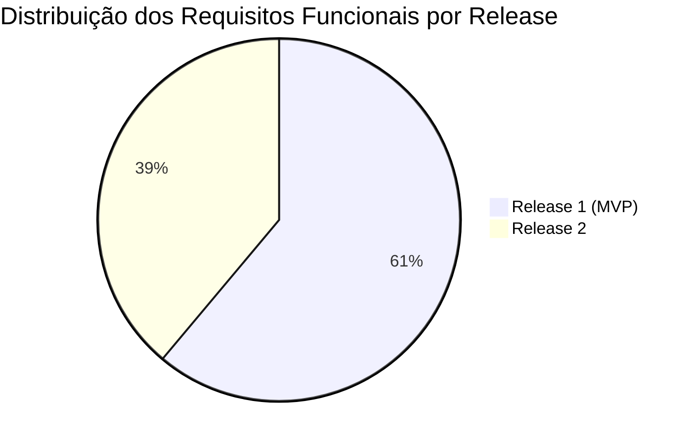

# Matriz de Rastreabilidade

A **Matriz de Rastreabilidade** garante a conexão bidirecional entre as Histórias de Usuário, Requisitos Funcionais, Requisitos Não-Funcionais e Regras de Negócio do sistema.

---

## 🧭 Mapeamento Cruzado dos Artefatos

| História de Usuário | Requisito Funcional | Requisito Não-Funcional | Regra de Negócio | Status de Cobertura |
| :--- | :--- | :--- | :--- | :---: |
| [US-001](historias-de-usuario.md#us-001-criar-conta-e-autenticar) | [RF-001](funcionais.md#rf-001-cadastro-de-usuario), [RF-002](funcionais.md#rf-002-autenticacao-e-gestao-de-sessao) | [RNF-001](nao-funcionais.md#rnf-001-desempenho-e-transicoes-spa), [RNF-006](nao-funcionais.md#rnf-006-seguranca-e-protecao-de-dados) | [RN-001](regras-de-negocio.md#rn-001-unicidade-de-credenciais-de-usuario), [RN-002](regras-de-negocio.md#rn-002-bloqueio-por-tentativas-invalidas-de-login) | :white_check_mark: Mapeado |
| [US-002](historias-de-usuario.md#us-002-cadastrar-produto-via-url) | [RF-005](funcionais.md#rf-005-cadastro-de-produto-para-monitoramento) | [RNF-001](nao-funcionais.md#rnf-001-desempenho-e-transicoes-spa), [RNF-004](nao-funcionais.md#rnf-004-processamento-assincrono-e-filas) | [RN-003](regras-de-negocio.md#rn-003-validacao-de-dominios-suportados), [RN-004](regras-de-negocio.md#rn-004-unicidade-de-url-por-usuario) | :white_check_mark: Mapeado |
| [US-003](historias-de-usuario.md#us-003-gerenciar-lista-de-itens) | [RF-006](funcionais.md#rf-006-listagem-e-consulta-de-produtos), [RF-009](funcionais.md#rf-009-exclusao-de-produto-monitorado) | [RNF-001](nao-funcionais.md#rnf-001-desempenho-e-transicoes-spa), [RNF-007](nao-funcionais.md#rnf-007-interface-responsiva) | - | :white_check_mark: Mapeado |
| - | [RF-010](funcionais.md#rf-010-coleta-automatica-e-periodica-de-precos), [RF-011](funcionais.md#rf-011-extracao-de-preco-e-disponibilidade), [RF-012](funcionais.md#rf-012-politica-de-retentativas-em-falha) | [RNF-004](nao-funcionais.md#rnf-004-processamento-assincrono-e-filas), [RNF-005](nao-funcionais.md#rnf-005-resiliencia-de-scraping), [RNF-008](nao-funcionais.md#rnf-008-observabilidade-e-logs) | [RN-005](regras-de-negocio.md#rn-005-intervalo-minimo-de-coleta-por-dominio), [RN-006](regras-de-negocio.md#rn-006-politica-de-retentativas-em-falha) | :white_check_mark: Mapeado |
| - | [RF-013](funcionais.md#rf-013-armazenamento-do-historico-de-precos) | [RNF-004](nao-funcionais.md#rnf-004-processamento-assincrono-e-filas) | [RN-007](regras-de-negocio.md#rn-007-descarte-de-leituras-duplicadas-sem-variacao) | :white_check_mark: Mapeado |
| [US-004](historias-de-usuario.md#us-004-receber-alerta-de-queda-de-preco) | [RF-016](funcionais.md#rf-016-disparo-de-notificacao-por-e-mail) | [RNF-004](nao-funcionais.md#rnf-004-processamento-assincrono-e-filas) | [RN-008](regras-de-negocio.md#rn-008-condicao-de-disparo-de-alerta), [RN-009](regras-de-negocio.md#rn-009-evitar-notificacoes-repetitivas-cooldown) | :white_check_mark: Mapeado |
| - | [RF-014](funcionais.md#rf-014-visualizacao-grafica-da-evolucao-de-precos), [RF-015](funcionais.md#rf-015-destaque-de-menor-preco-historico) | [RNF-001](nao-funcionais.md#rnf-001-desempenho-e-transicoes-spa), [RNF-007](nao-funcionais.md#rnf-007-interface-responsiva) | - | :white_check_mark: Mapeado |

---

## 📊 Cobertura Atual

> [!TIP]
> A matriz é revisada a cada sprint ou refinamento do backlog para assegurar que cada funcionalidade em desenvolvimento corresponda a um requisito formalizado.
