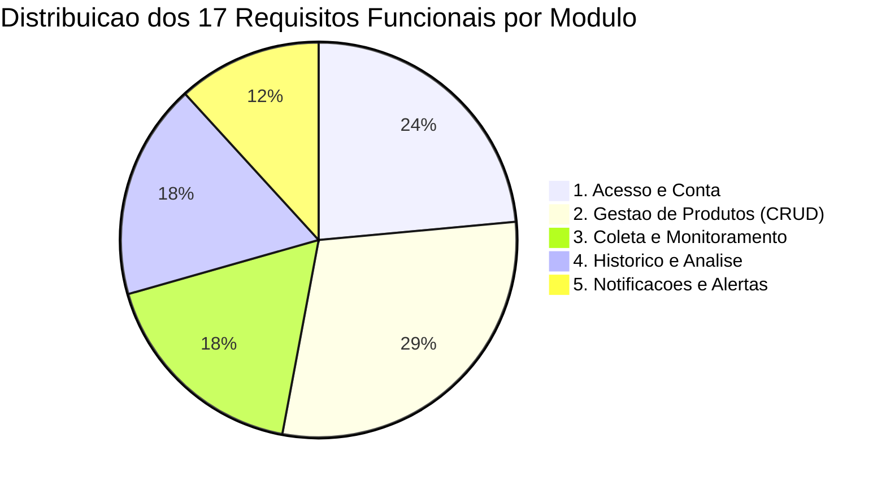

# Matriz de Rastreabilidade

A **Matriz de Rastreabilidade** garante a conexao bidirecional entre as Historias de Usuario, Requisitos Funcionais, Requisitos Nao-Funcionais e Regras de Negocio do sistema, consolidando o escopo da **Release 1 (MVP Completo)**.

---

## Mapeamento Cruzado dos Artefatos

| Historia de Usuario | Requisito Funcional | Requisito Nao-Funcional | Regra de Negocio | Status de Cobertura |
| :--- | :--- | :--- | :--- | :---: |
| [US-001](historias-de-usuario.md#us-001-criar-conta-verificar-e-mail-e-autenticar) | [RF-001](funcionais.md#rf-001-cadastro-de-usuario-e-verificacao-de-e-mail), [RF-002](funcionais.md#rf-002-autenticacao-e-gestao-de-sessao), [RF-003](funcionais.md#rf-003-recuperacao-de-senha), [RF-004](funcionais.md#rf-004-gerenciamento-de-perfil-e-conta) | [RNF-001](nao-funcionais.md#rnf-001-desempenho-e-transicoes-spa), [RNF-002](nao-funcionais.md#rnf-002-ambiente-hibrido-docker-compose-e-laravel-herd), [RNF-003](nao-funcionais.md#rnf-003-compatibilidade-framework-e-localizacao-pt_br), [RNF-006](nao-funcionais.md#rnf-006-seguranca-e-protecao-de-dados) | [RN-001](regras-de-negocio.md#rn-001-unicidade-de-credenciais-de-usuario), [RN-002](regras-de-negocio.md#rn-002-bloqueio-por-tentativas-invalidas-de-login) | Mapeado |
| [US-002](historias-de-usuario.md#us-002-cadastrar-produto-via-url-com-categoria) | [RF-005](funcionais.md#rf-005-cadastro-de-produto-para-monitoramento), [RF-010](funcionais.md#rf-010-coleta-automatica-periodica-e-sob-demanda), [RF-011](funcionais.md#rf-011-extracao-de-preco-a-vista-a-prazo-e-disponibilidade) | [RNF-001](nao-funcionais.md#rnf-001-desempenho-e-transicoes-spa), [RNF-004](nao-funcionais.md#rnf-004-processamento-assincrono-e-filas), [RNF-006](nao-funcionais.md#rnf-006-seguranca-e-protecao-de-dados) | [RN-003](regras-de-negocio.md#rn-003-validacao-de-dominios-suportados), [RN-004](regras-de-negocio.md#rn-004-unicidade-de-url-por-usuario), [RN-010](regras-de-negocio.md#rn-010-limite-de-produtos-por-usuario) | Mapeado |
| [US-003](historias-de-usuario.md#us-003-gerenciar-editar-pausar-e-atualizar-produtos) | [RF-006](funcionais.md#rf-006-listagem-e-consulta-de-produtos), [RF-007](funcionais.md#rf-007-edicao-de-parametros-do-produto), [RF-008](funcionais.md#rf-008-pausar-e-retomar-monitoramento), [RF-009](funcionais.md#rf-009-exclusao-de-produto-monitorado), [RF-010](funcionais.md#rf-010-coleta-automatica-periodica-e-sob-demanda), [RF-012](funcionais.md#rf-012-politica-de-retentativas-em-falha) | [RNF-001](nao-funcionais.md#rnf-001-desempenho-e-transicoes-spa), [RNF-004](nao-funcionais.md#rnf-004-processamento-assincrono-e-filas), [RNF-005](nao-funcionais.md#rnf-005-resiliencia-de-scraping-http), [RNF-007](nao-funcionais.md#rnf-007-interface-responsiva), [RNF-008](nao-funcionais.md#rnf-008-observabilidade-e-logs) | [RN-005](regras-de-negocio.md#rn-005-intervalo-minimo-de-coleta-por-dominio), [RN-006](regras-de-negocio.md#rn-006-politica-de-retentativas-em-falha) | Mapeado |
| [US-004](historias-de-usuario.md#us-004-analisar-evolucao-grafica-e-menor-preco-historico) | [RF-013](funcionais.md#rf-013-armazenamento-do-historico-de-precos), [RF-014](funcionais.md#rf-014-visualizacao-grafica-da-evolucao-de-precos), [RF-015](funcionais.md#rf-015-destaque-de-menor-preco-historico) | [RNF-001](nao-funcionais.md#rnf-001-desempenho-e-transicoes-spa), [RNF-004](nao-funcionais.md#rnf-004-processamento-assincrono-e-filas), [RNF-007](nao-funcionais.md#rnf-007-interface-responsiva) | [RN-007](regras-de-negocio.md#rn-007-descarte-de-leituras-duplicadas-sem-variacao) | Mapeado |
| [US-005](historias-de-usuario.md#us-005-receber-alerta-de-queda-de-preco-e-retorno-ao-estoque) | [RF-016](funcionais.md#rf-016-disparo-de-notificacao-por-e-mail-e-central-de-alertas), [RF-017](funcionais.md#rf-017-alerta-de-retorno-ao-estoque) | [RNF-004](nao-funcionais.md#rnf-004-processamento-assincrono-e-filas) | [RN-008](regras-de-negocio.md#rn-008-condicao-de-disparo-de-alerta), [RN-009](regras-de-negocio.md#rn-009-evitar-notificacoes-repetitivas-cooldown) | Mapeado |

---

## Cobertura Atual por Modulo (Release 1 — MVP Completo)

