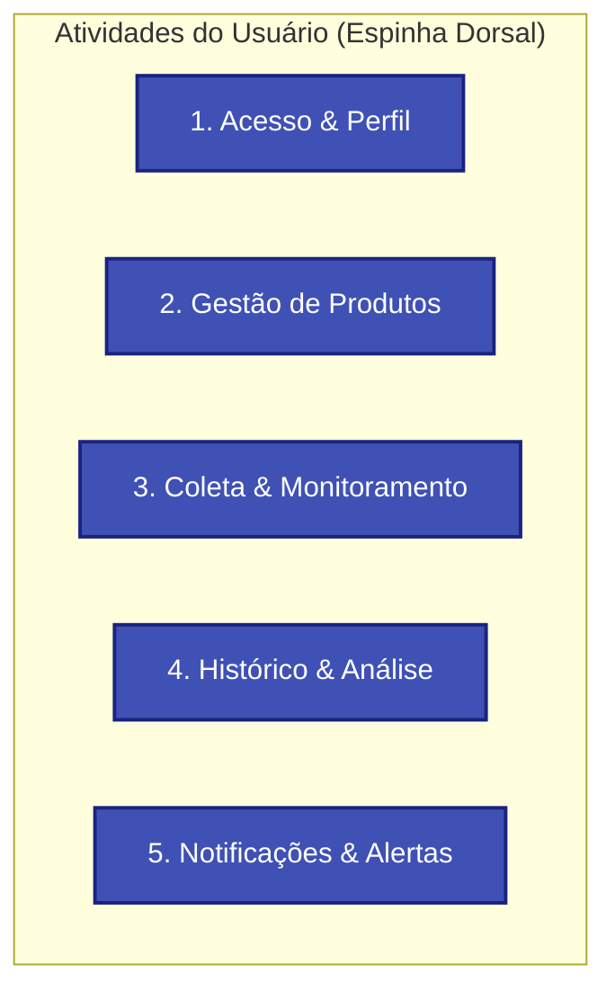

# User Story Mapping

O **Story Map** organiza a jornada do usuário e a visão de entrega incremental do sistema de **Monitoramento de Preços**. Ele distribui as necessidades dos usuários em uma linha do tempo (atividades essenciais) e divide a implementação em fatias de valor (*releases*), garantindo a entrega rápida de um **MVP** funcional.

---

## 🗺️ Mapa de Histórias do Sistema

---

## 📋 Detalhamento por Fatias de Entrega (*Releases*)

### 🟢 Release 1 — MVP (Produto Mínimo Viável)
> **Meta:** O fluxo ponta a ponta mais enxuto que gera valor imediato — cadastrar uma URL, rastrear o preço em segundo plano e disparar um e-mail quando atingir o valor desejado.

| 1. Acesso & Perfil | 2. Gestão de Produtos | 3. Coleta & Monitoramento | 4. Histórico & Análise | 5. Notificações & Alertas |
| :--- | :--- | :--- | :--- | :--- |
| • Registro e login simples de usuário | • Cadastrar produto informando URL e Preço Alvo | • Agendamento periódico de checagem (Cron/Queue) | • Salvar histórico de variações de preço no banco | • Disparo de e-mail ao atingir preço alvo |
| • Logout e proteção de rotas | • Listar itens monitorados com preço atual | • Extração de preço e status (em estoque / esgotado) | • Exibir preço atual vs. preço alvo na listagem | • Respeitar regra de não repetir alerta imediatamente |
| | • Excluir produto monitorado | • Tratamento básico de falhas de conexão | | |

---

### 🟡 Release 2 — Experiência do Usuário & Múltiplos Canais
> **Meta:** Expandir canais de aviso, melhorar visualização de oscilações e dar mais controle ao usuário.

| 1. Acesso & Perfil | 2. Gestão de Produtos | 3. Coleta & Monitoramento | 4. Histórico & Análise | 5. Notificações & Alertas |
| :--- | :--- | :--- | :--- | :--- |
| • Recuperação de senha | • Edição de apelido, categoria e preço alvo | • Pausar e retomar monitoramento individual | • Gráfico interativo com oscilação histórica de preço | • Canal de notificação via Telegram |
| • Vincular identificador de canais (ex: Telegram ID) | • Validação automática do domínio da URL | • Retentativas com espaçamento exponencial (*backoff*) | • Destaque visual: Menor preço histórico já registrado | • Notificação de produto voltando ao estoque |

---

### 🟣 Release 3 — Funcionalidades Avançadas & Otimização
> **Meta:** Inteligência de compra, relatórios e facilidade de captura.

| 1. Acesso & Perfil | 2. Gestão de Produtos | 3. Coleta & Monitoramento | 4. Histórico & Análise | 5. Notificações & Alertas |
| :--- | :--- | :--- | :--- | :--- |
| • Preferências de horários de silêncio para avisos | • Organização de itens por Tags / Listas de Desejos | • Suporte a páginas com renderização pesada em JavaScript | • Cálculo de "desconto real" vs. oscilação artificial de preços | • Notificação via Webhooks customizados / WhatsApp |
| • Autenticação de dois fatores (2FA) | • Importação / Exportação de listas em CSV | • Rotação de proxies e User-Agents avançados | • Comparador de preço entre lojas para o mesmo item | • Central de notificações interna na plataforma |

---

## 💡 Funcionalidades Sugeridas e Justificativas

1. **Histórico Visual e Gráficos de Variação:**
   - *Por que incluir:* O usuário de monitoramento não quer apenas saber o preço de hoje; ele quer saber se o valor atual é uma promoção real ou se o item já esteve mais barato na semana anterior.
2. **Organização por Categorias ou Listas de Desejos:**
   - *Por que incluir:* Quando o usuário monitora muitos itens (ex: hardware, livros, eletrodomésticos), poder agrupar e filtrar torna a interface muito mais produtiva.
3. **Indicador de Disponibilidade / Estoque:**
   - *Por que incluir:* Uma queda brusca de preço frequentemente ocorre quando o produto se esgota. Monitorar a disponibilidade evita alertas falsos de itens indisponíveis.
