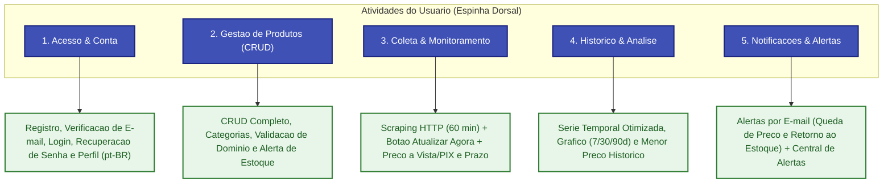

# User Story Mapping

O **Story Map** organiza a jornada do usuario e a visao de entrega consolidada do sistema de **Monitoramento de Precos**. Ele distribui as necessidades dos usuarios ao longo das **5 atividades essenciais** da plataforma, concentrando o escopo em uma **Release 1 (MVP Completo)** enxuta, coesa e de alto valor.

---

## Mapa de Historias do Sistema

---

## Escopo Consolidado — Release 1 (MVP Completo)

> **Meta:** Entregar a jornada completa e enxuta em Portugues do Brasil (`pt_BR`) — desde o cadastro com verificacao de e-mail ate o CRUD completo de produtos categorizados, coleta periodica e sob demanda dos precos a vista (PIX) e a prazo, analise grafica de variacoes e alertas inteligentes por e-mail.

| 1. Acesso & Conta | 2. Gestao de Produtos | 3. Coleta & Monitoramento | 4. Historico & Analise | 5. Notificacoes & Alertas |
| :--- | :--- | :--- | :--- | :--- |
| • Cadastro de usuario com nome, e-mail e senha (`RF-001`) | • Cadastrar produto com URL, Preco Alvo, Apelido, Categoria e checkbox de alerta de estoque (`RF-005`) | • Agendamento periodico a cada 60 min via Scheduler e Redis Queues (`RF-010`) | • Salvar historico de preco a vista e a prazo quando houver variacao (`RF-013`, `RN-007`) | • Disparo de e-mail ao atingir ou ficar abaixo do Preco Alvo (`RF-016`, `RN-008`) |
| • Verificacao obrigatoria de e-mail no cadastro (`MustVerifyEmail`) | • Validacao dos 5 dominios homologados (`RN-003`) e higienizacao de URL (`RN-004`) | • Botao "Verificar agora" para atualizacao manual sob demanda (rate limit 10 min) | • Grafico interativo em Vue 3 com filtros de 7, 30 e 90 dias (`RF-014`) | • Alerta por e-mail quando produto esgotado voltar ao estoque (`RF-017`) |
| • Login com Rate Limit de 5 tentativas (`RF-002`, `RN-002`) e Logout | • Listagem com filtro por categoria, exibindo preco a vista/PIX, preco a prazo e estoque (`RF-006`) | • Extracao HTTP leve (`Guzzle + DomCrawler`) de preco a vista/PIX, a prazo e estoque (`RF-011`) | • Card de destaque: Menor Preco Historico e % de desconto sobre a media (`RF-015`) | • Regra de silencio (*Cooldown*) de 6 horas ou queda adicional de 5% (`RN-009`) |
| • Recuperacao de senha via link por e-mail (`RF-003`) | • Edicao de preco alvo, apelido, categoria e preferencia de estoque (`RF-007`) | • Rate limit de 3s por dominio (`RN-005`) e 3 retentativas exponenciais (`RF-012`, `RN-006`) | | • Central de Alertas na interface listando o historico de notificacoes enviadas |
| • Gerenciamento de perfil, troca de senha e exclusao de conta (`RF-004`) | • Pausar, retomar (`RF-008`) e excluir produto monitorado (`RF-009`, `RN-010`) | | | |

---

## Itens Excluidos do Escopo (Simplificacao Arquitetural)

Para manter a aplicacao enxuta, de facil manutencao e baixo custo operacional, os seguintes itens foram formalmente removidos do escopo:

1. **Autenticacao em Dois Fatores (2FA) e Passkeys:** O sistema adota autenticacao direta por e-mail e senha com verificacao de e-mail obrigatoria.
2. **Integracao com Bot do Telegram:** Todas as notificacoes externas sao centralizadas no canal de E-mail (SMTP / Mailpit em ambiente local) e na Central de Alertas da interface web.
3. **Renderizacao via Headless Chrome (`Spatie Browsershot`):** A coleta utiliza requisicoes HTTP leves (`GuzzleHTTP + Symfony DomCrawler`), evitando sobrecarga de memoria nos containers Docker.
4. **Funcionalidades de Release 3 (Importacao CSV, Comparador Multicontas, Webhooks/WhatsApp):** Removidas para preservar o foco no ciclo central de monitoramento e analise de precos.
